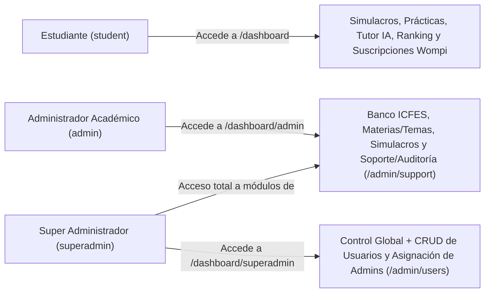

# ATHENA — PLATAFORMA DE PREPARACIÓN PARA LAS PRUEBAS SABER 11
## DOCUMENTACIÓN MAESTRA DEL PROYECTO
**Versión 1.1 — Versión Oficial Consolidada (Microservicios, Docker, RBAC 3 Roles & Pasarela Wompi)**  
**Servicio Nacional de Aprendizaje – SENA**  
**Centro de Comercio y Servicios · Regional Cauca**  
**Ficha:** 3223898  
**Año:** 2026  

---

### Equipo de Desarrollo
- **Isabel Viviana Paredes**
- **Yosuad Valdez Castillo**
- **Franci Johana Rivera**
- **Sebastián Acevedo**
- **Jersin Benavidez**

---

### Control del Documento

| Campo | Detalle |
| :--- | :--- |
| **Nombre** | Documentación Maestra del Proyecto ATHENA |
| **Versión** | 1.1 – Consolidada y Sincronizada frente al Código Fuente Real (Rama `Hotfix`) |
| **Estado** | Aprobada para desarrollo, auditoría QA y despliegue contenerizado |
| **Responsables** | Equipo de desarrollo ATHENA – Ficha 3223898 |
| **Institución** | SENA – Regional Cauca (Centro de Comercio y Servicios) |
| **Propósito** | Documentar con precisión la arquitectura real vigente en Docker Compose, el sistema de autenticación híbrido (Firebase Auth + Laravel Sanctum), el control de acceso basado en 3 roles (`superadmin`, `admin`, `student`), el Tutor IA con Markdown/KaTeX e historial en MongoDB, el microservicio `athena-question-bank` y la pasarela de pagos Wompi integrada con PostgreSQL. |

---

### Historial de Cambios

| Versión | Fecha | Descripción de Cambios | Responsable |
| :--- | :--- | :--- | :--- |
| **0.1** | Octubre 2026 | Borrador inicial preliminar (supuestos monolíticos Laragon y MySQL). | Equipo ATHENA |
| **0.3** | Noviembre 2026 | Integración de contexto de migración, auditoría de respaldo y diseño del microservicio Question Bank. | Equipo ATHENA |
| **1.0** | Noviembre 2026 | Incorporación de la arquitectura de microservicios contenerizados con Docker Compose, migración de Core a PostgreSQL 16 Alpine, desacoplamiento de `athena-question-bank` con Supabase (PostgreSQL + S3 Storage) y Gateway Nginx en puerto 8080. | Equipo ATHENA |
| **1.1** | Noviembre 2026 | **Actualización Integral Post-Integración:** Unificación de RBAC a 3 roles activos (`superadmin`, `admin`, `student`), selector forzado de cuentas Google (`prompt: 'select_account'`), logout atómico Firebase + Sanctum, CRUD exclusivo de usuarios/roles para SuperAdmin (`/api/users/*`), Tutor IA con renderizado Markdown/KaTeX y Off-canvas Drawer derecho en CSS puro, e integración completa de la pasarela oficial Wompi (Widget + Web Checkout en nueva pestaña + polling automático + Webhook firmado SHA-256). | Equipo ATHENA |

---

## Tabla de Contenido

1. [Introducción y Justificación](#1-introducción-y-justificación)
2. [Identificación y Contexto del Proyecto](#2-identificación-y-contexto-del-proyecto)
3. [Objetivos del Proyecto](#3-objetivos-del-proyecto)
4. [Alcance y Módulos Productivos](#4-alcance-y-módulos-productivos)
5. [Actores y Modelo Simplificado de 3 Roles (RBAC)](#5-actores-y-modelo-simplificado-de-3-roles-rbac)
6. [Requisitos del Sistema (Funcionales y No Funcionales)](#6-requisitos-del-sistema-funcionales-y-no-funcionales)
7. [Historias de Usuario y Trazabilidad Técnica Real](#7-historias-de-usuario-y-trazabilidad-técnica-real)
8. [Arquitectura y Diseño Técnico Oficial (Docker Compose)](#8-arquitectura-y-diseño-técnico-oficial-docker-compose)
9. [Persistencia Políglota y Modelo de Datos](#9-persistencia-políglota-y-modelo-de-datos)
10. [Descripción Detallada de Módulos Críticos](#10-descripción-detallada-de-módulos-críticos)
11. [Interfaces, Identidad Visual y Convención de CSS Puro](#11-interfaces-identidad-visual-y-convención-de-css-puro)
12. [Instalación, Configuración y Despliegue con Docker](#12-instalación-configuración-y-despliegue-con-docker)
13. [Integraciones Externas y Servicios Cloud](#13-integraciones-externas-y-servicios-cloud)
14. [Seguridad, Privacidad Anti-IDOR y Control de Sesiones](#14-seguridad-privacidad-anti-idor-y-control-de-sesiones)
15. [Plan y Evidencias de Pruebas](#15-plan-y-evidencias-de-pruebas)
16. [Matriz Comparativa de Evolución (v0.1 vs v1.1 Actual)](#16-matriz-comparativa-de-evolución-v01-vs-v11-actual)
17. [Glosario de Términos](#17-glosario-de-términos)

---

## 1. Introducción y Justificación

**ATHENA** es una plataforma tecnológica orientada a cerrar brechas de preparación académica para las pruebas de Estado **ICFES Saber 11** en Colombia. Tradicionalmente, los estudiantes enfrentan limitaciones para acceder a material oficial clasificado, simulacros con retroalimentación inmediata y acompañamiento personalizado para comprender por qué fallaron en una pregunta.

ATHENA soluciona esta problemática mediante:
1. **Simulacros y Prácticas Reales:** Evaluaciones configurables organizadas por las 5 áreas oficiales del ICFES (Matemáticas, Lectura Crítica, Ciencias Naturales, Sociales y Ciudadanas, e Inglés), implementando algoritmos que respetan la indivisibilidad de lecturas e infografías compartidas.
2. **Acompañamiento Socrático con IA:** El tutor inteligente **ATHENA IA** (representado por la identidad del *Zorro ATHENA*), impulsado por **Google Gemini**, con soporte de fórmulas matemáticas (**KaTeX**), formato enriquecido (**Markdown GFM**) e historial persistente por estudiante en **MongoDB**.
3. **Ingesta y Extracción Automatizada (`athena-question-bank`):** Un microservicio desacoplado capaz de recibir cuadernillos oficiales en PDF y procesarlos con IA multimodal para extraer preguntas, enunciados, tablas, diagramas y opciones.
4. **Suscripciones y Pasarela Oficial Wompi:** Gestión real de planes Premium (Mensual, Trimestral y Anual) en PostgreSQL integrada con Wompi Bancolombia (Widget Oficial, Web Checkout y confirmación asíncrona vía Webhook firmado).
5. **Infraestructura Contenerizada:** Despliegue estándar y reproducible bajo Docker Compose.

---

## 2. Identificación y Contexto del Proyecto

| Parámetro | Detalle Institucional |
| :--- | :--- |
| **Nombre Oficial** | ATHENA — Plataforma de Preparación para las Pruebas Saber 11 |
| **Institución** | Servicio Nacional de Aprendizaje – SENA |
| **Centro de Formación** | Centro de Comercio y Servicios |
| **Regional** | Regional Cauca |
| **Programa y Ficha** | Análisis y Desarrollo de Software (ADSO) — Ficha 3223898 |
| **Público Objetivo** | Estudiantes de educación media (grados 10° y 11°) y bachilleres aspirantes a educación superior |
| **Canales Oficiales** | Plataforma Web SPA (React 19 + Vite 8 + CSS Puro en Tema Oscuro) |
| **Identidad Visual** | Mascota pedagógica *Zorro ATHENA* |

---

## 3. Objetivos del Proyecto

### 3.1 Objetivo General
Desarrollar, desplegar y operar una plataforma tecnológica integral para la preparación de las pruebas ICFES Saber 11, integrando prácticas temáticas, simulacros con cronómetro, seguimiento analítico del rendimiento, tutoría socrática mediante inteligencia artificial y gestión de suscripciones con pasarela de pagos real.

### 3.2 Objetivos Específicos
1. **Módulo de Prácticas y Simulacros:** Diseñar un motor de exámenes que permita presentar simulacros diagnósticos y prácticas focalizadas por materia con registro inmutable (*snapshot*).
2. **Tutor Inteligente Socrático:** Integrar Google Gemini con renderizado de ecuaciones matemáticas en LaTeX/KaTeX, almacenando el historial privado de cada estudiante en MongoDB.
3. **Automatización de Ingesta de Reactivos:** Operar el microservicio `athena-question-bank` para la recepción de PDFs oficiales, extracción multimodal de enunciados y diagramas, y moderación pedagógica previa a publicación.
4. **Seguridad y Control de Acceso (RBAC):** Garantizar autenticación híbrida (Firebase Auth / Google OAuth + Laravel Sanctum) con validación estricta de estado de cuenta en PostgreSQL y separación en 3 roles (`superadmin`, `admin`, `student`).
5. **Pasarela de Pagos y Suscripciones:** Gestionar planes y suscripciones reales en PostgreSQL mediante Wompi Colombia con verificación criptográfica de integridad y eventos Webhook.

---

## 4. Alcance y Módulos Productivos

### 4.1 Funcionalidades Implementadas y Activas
- ✅ **Autenticación Híbrida y OAuth Google:** Inicio de sesión con correo/contraseña y Google Popup (`prompt: 'select_account'`) vía Firebase Auth, interchanging ID Tokens por tokens Bearer de Laravel Sanctum verificados contra PostgreSQL.
- ✅ **Control de Cuentas Bloqueadas en Tiempo Real:** Middleware `EnsureUserIsActive` (`active`) que rechaza con HTTP `403 ACCOUNT_BLOCKED` y revoca tokens Sanctum si una cuenta es suspendida por el SuperAdmin.
- ✅ **Recuperación y Cambio de Contraseña:** Flujo coordinado entre Firebase Auth (`sendPasswordResetEmail`, `confirmPasswordReset`, `updatePassword`) y PostgreSQL (`/api/auth/forgot-password`, `/api/auth/reset-password`, `/api/auth/change-password`).
- ✅ **Simplificación de Roles (3 Roles Activos):** `superadmin` (`/dashboard/superadmin`), `admin` (`/dashboard/admin`, con módulo integrado de **Soporte y Auditoría** en `/admin/support`) y `student` (`/dashboard`).
- ✅ **CRUD Completo de Usuarios y Asignación de Roles (Exclusivo SuperAdmin):** Gestión en vivo sobre PostgreSQL (`/api/users/*`) para crear cuentas, promover/degradar entre Estudiante y Administrador, bloquear/desbloquear sesiones y eliminar usuarios con reglas de autoprotección.
- ✅ **Tutor IA con Markdown, KaTeX y Drawer Desplegable:** Componente `ChatMessage.jsx` (`react-markdown`, `remark-gfm`, `remark-math`, `rehype-katex`), historial privado en MongoDB (`AiConversation`, `ChatHistory`) con protección Anti-IDOR y panel lateral derecho tipo *Off-canvas Drawer* en CSS puro.
- ✅ **Pasarela de Pagos Wompi Unificada (`/suscripciones` y `/payments`):** Creación de suscripciones pendientes con referencia HMAC-SHA256, soporte dual para **Widget Oficial de Wompi** y **Web Checkout en nueva pestaña**, ruta pública de retorno `/payment-return`, polling automático cada 3 segundos + detección de foco de pestaña, y activación vía webhook firmado `POST /api/payments/webhook`.
- ✅ **Banco de Preguntas y Extracción PDF (`athena-question-bank`):** Carga de cuadernillos a Supabase Storage S3, extracción con Gemini y moderación de reactivos (`draft`, `review`, `published`, `archived`).

### 4.2 Elementos Fuera del Alcance Actual
- ⏳ **Google Play Billing In-App Nativo:** Exclusivo para futuras publicaciones comerciales en tienda móvil.
- ⏳ **Proctoring Biométrico por Cámara Web:** No requerido para simulacros formativos de entrenamiento libre.

---

## 5. Actores y Modelo Simplificado de 3 Roles (RBAC)

El sistema maneja **únicamente 3 roles activos** normalizados en PostgreSQL (`User::normalizeRole`) y en el cliente React (`normalizeUserRole` en `useAuthStore.js`). Cualquier valor heredado (`super_admin`, `support`, `docente`, `coordinador`) se normaliza automáticamente sin romper cuentas existentes:



| Rol en PostgreSQL | Ruta Inicial (`getRedirectPathByRole`) | Permisos y Alcance | Restricciones Estrictas |
| :--- | :--- | :--- | :--- |
| **`superadmin`** | `/dashboard/superadmin` | Acceso total al Panel Ejecutivo SuperAdmin, **CRUD completo de Usuarios y Roles** (`/admin/users`, `/api/users/*`), diagnóstico de BD (`/api/test-db/*`), Banco ICFES, Materias, Simulacros y Soporte. | No puede eliminarse, bloquearse ni quitarse el rol `superadmin` a sí mismo (validado en backend y frontend). |
| **`admin`** | `/dashboard/admin` | Gestión académica del Banco ICFES (`/admin/questions`), Materias y Temas (`/admin/subjects`), Simulacros (`/admin/exams`) y módulo integrado de **Soporte y Auditoría** (`/admin/support`). | **Sin acceso** a `/dashboard/superadmin` ni a `/admin/users` (`/api/users/*`). No puede crear, modificar ni eliminar otros administradores ni superadministradores. |
| **`student`** | `/dashboard` | Presentación de simulacros y prácticas, Tutor IA, estadísticas, ranking, perfil y compra de suscripciones con Wompi (`/suscripciones`). | **Sin acceso** a ninguna ruta administrativa (`/admin/*`, `/dashboard/admin`, `/dashboard/superadmin`). |

---

## 6. Requisitos del Sistema (Funcionales y No Funcionales)

### 6.1 Requisitos Funcionales (RF)

| Código | Módulo | Descripción Funcional | Estado en v1.1 | Componente Responsable |
| :--- | :--- | :--- | :--- | :--- |
| **RF-01** | Autenticación Híbrida | Login/Registro tradicional y con Google OAuth (`prompt: 'select_account'`), validación de bloqueo y cierre atómico en Firebase + Sanctum. | **Hecho** | `AuthController.php` / `useAuthStore.js` |
| **RF-02** | RBAC de 3 Roles | Enrutamiento directo por rol (`superadmin`, `admin`, `student`) y protección con `RoleMiddleware`, `EnsureUserIsActive`, `AdminRoute` y `ProtectedRoute`. | **Hecho** | Core Backend / React Router |
| **RF-03** | CRUD Usuarios y Roles | Listado, filtro por rol/estado, búsqueda, creación, edición, promoción Admin/Estudiante, bloqueo con revocación Sanctum y eliminación. | **Hecho** | `Admin\UserController.php` / `users.jsx` |
| **RF-04** | Tutor IA + Historial | Chat socrático con Gemini, fórmulas KaTeX, tablas Markdown, Off-canvas Drawer derecho y persistencia privada Anti-IDOR en MongoDB. | **Hecho** | `AIController.php` / `AiService.php` / `chat.jsx` |
| **RF-05** | Suscripciones y Wompi | Catálogo de planes en PostgreSQL, checkout firmado SHA-256 (Widget + Web Checkout en nueva pestaña), polling en vivo y Webhook `transaction.updated`. | **Hecho** | `PaymentController.php` / `WompiWebhookController.php` / `subscription.jsx` |
| **RF-06** | Prácticas y Simulacros | Selección atómica de preguntas por área/tema respetando grupos de lectura (`stimulus_id`), calificación y `snapshot_data`. | **Hecho** | `ExamService.php` / `athena-question-bank` |
| **RF-07** | Extracción PDF Multimodal | Carga de PDFs a Supabase S3, extracción con Gemini, recorte de figuras con `PdfImageExtractor.php` y bandeja de revisión IQPE. | **Hecho** | Microservicio `athena-question-bank` |
| **RF-08** | Gateway Unificado | Proxy inverso Nginx en puerto `8080` hacia `/api/` (`athena-backend:8000`) y `/question-bank/` (`question-bank:8000`). | **Hecho** | `ATHENAreact/nginx.conf` |

### 6.2 Requisitos No Funcionales (RNF)

| Atributo | Criterio Técnico Oficial | Mecanismo de Garantía en v1.1 |
| :--- | :--- | :--- |
| **Estilos Frontend** | **100% CSS Puro en Tema Oscuro (0% Tailwind CSS)** en vistas y componentes. | Hojas de estilo modulares (`.css`) con variables CSS y nomenclatura semántica. |
| **Seguridad de Sesión** | Revocación inmediata al bloquear un usuario o cerrar sesión. | `$user->tokens()->delete()`, middleware global `EnsureUserIsActive` e interceptor Axios 403 `ACCOUNT_BLOCKED`. |
| **Privacidad Anti-IDOR** | Aislamiento estricto de datos por estudiante autenticado. | Consultas a MongoDB y PostgreSQL filtradas obligatoriamente por `$request->user()->id`. |
| **Integridad de Pagos** | Prevención de alteración de montos y referencias en Wompi. | Firma `signature:integrity` SHA-256, referencia con HMAC-SHA256 y validación de `signature.checksum` en Webhook. |

---

## 7. Historias de Usuario y Trazabilidad Técnica Real

### Módulo 1: Autenticación, Seguridad y Recuperación
- **HU01 [Hecho]:** Registro e inicio de sesión con correo y contraseña (`POST /api/auth/register`, `POST /api/auth/login`).
- **HU02 / HU05 [Hecho]:** Inicio de sesión con Google OAuth mediante Firebase Popup (`googleProvider.setCustomParameters({ prompt: 'select_account' })`) e intercambio verificado en `POST /api/auth/firebase-login`.
- **HU03 / HU06 [Hecho]:** Recuperación y restablecimiento de contraseña sincronizado entre Firebase Auth y PostgreSQL (`POST /api/auth/forgot-password`, `POST /api/auth/reset-password`, vistas `forgot_password.jsx` y `reset_password.jsx`).
- **HU04 [Hecho]:** Cierre de sesión limpio en Estudiante, Admin y SuperAdmin que revoca el token en Laravel (`POST /api/auth/logout`) antes de limpiar `localStorage` y ejecuta `signOut(firebaseAuth)`.

### Módulo 2: Administración, Roles y Usuarios
- **HU07 / HU08 [Hecho]:** Separación automática en 3 roles (`superadmin`, `admin`, `student`). Eliminado el selector manual de vistas ("Vistas Autorizadas") y el rol separado de soporte; cada cuenta ingresa directamente al panel que corresponde a su rol en PostgreSQL.
- **HU09 / HU10 [Hecho]:** CRUD completo de usuarios y asignación de administradores en `/admin/users` (`GET/POST /api/users`, `PUT/DELETE /api/users/{id}`, `PATCH /api/users/{id}/role`, `PATCH /api/users/{id}/status`) exclusivo para `superadmin`.

### Módulo 3: Suscripciones y Pasarela Oficial Wompi
- **HU12 a HU16 [Hecho]:** Experiencia unificada de Suscripciones y Pagos (`/suscripciones`, `/subscriptions`, `/payments`) alimentada 100% desde PostgreSQL:
  - Consulta de planes reales (`GET /api/payments/plans`) e historial/plan activo (`GET /api/payments/history`).
  - Creación de orden pendiente y firma SHA-256 (`POST /api/payments/checkout`).
  - Pago mediante **Widget Oficial de Wompi** (con timeout de seguridad de 8s) o **Web Checkout en nueva pestaña** (`window.open` + enlace fallback).
  - Retorno limpio en `/payment-return` y actualización automática en vivo en la pestaña original (polling cada 3s hasta por 3 minutos + listeners `focus` y `visibilitychange`) al procesarse el webhook `POST /api/payments/webhook`.

### Módulo 4: Perfil Institucional
- **HU17 / HU18 [Hecho]:** Edición de perfil y cambio de contraseña verificando la clave actual en Firebase Auth y PostgreSQL (`POST /api/auth/change-password` sin doble hasheo).

### Módulo 5: Prácticas, Simulacros y Banco de Preguntas
- **HU21 a HU27 [Hecho]:** Prácticas por área, simulacros cronometrados, extracción multimodal de PDFs e integración de **Soporte y Auditoría** en `/admin/support` para `admin` y `superadmin`.

### Módulo 6: Tutor con Inteligencia Artificial (ATHENA IA)
- **HU29 a HU31 [Hecho]:** Chat socrático con formato Markdown/KaTeX (`ChatMessage.jsx`), guardado en MongoDB (`AiConversation` y `ChatHistory`) y menú lateral desplegable derecho (*Off-canvas Drawer*) con transición CSS pura.

---

## 8. Arquitectura y Diseño Técnico Oficial (Docker Compose)

### 8.1 Topología Multi-Contenedor

El sistema se orquesta mediante [docker-compose.yml](file:///c:/Users/xxrya/proyecto-ATHENA/docker-compose.yml) en la red privada `athena-network`:

```
                                      [ NAVEGADOR WEB ]
                                              │
                                       http://localhost:8080
                                              ▼
                             ┌──────────────────────────────────┐
                             │       athena-frontend            │
                             │  • Nginx Alpine (Gateway :80)    │
                             │  • React 19 + Vite 8 + CSS Puro  │
                             └────────┬─────────────────┬───────┘
                                      │                 │
                         Proxy /api/* │                 │ Proxy /question-bank/*
                                      ▼                 ▼
             ┌──────────────────────────────────┐     ┌──────────────────────────────────┐
             │         athena-backend           │     │       athena-question-bank       │
             │  • Laravel 12 + Sanctum (:8000)  │     │  • Laravel 12 (:8000 -> :8001)   │
             │  • Auth, RBAC, Users, Wompi, IA  │     │  • Extracción PDF Gemini + IQPE  │
             └────────┬─────────────────┬───────┘     └────────┬─────────────────┬───────┘
                      │                 │                      │                 │
                      ▼                 ▼                      ▼                 ▼
              ┌──────────────┐   ┌──────────────┐      ┌──────────────┐   ┌──────────────┐
              │  athena-db   │   │   MongoDB    │      │   Supabase   │   │   Supabase   │
              │PostgreSQL 16 │   │ (NoSQL Chat) │      │  PostgreSQL  │   │  Storage S3  │
              │ Puerto 5432  │   │  athena_ai   │      │  (Reactivos) │   │ (PDF/Media)  │
              └──────────────┘   └──────────────┘      └──────────────┘   └──────────────┘
```

### 8.2 Servicios en `docker-compose.yml`

| Servicio | Contenedor | Contexto de Build | Puerto Host | Propósito Principal |
| :--- | :--- | :--- | :--- | :--- |
| **`frontend`** | `athena-frontend` | `./ATHENAreact` | `8080:80` | Sirve la SPA compilada con Vite y actúa como Reverse Proxy Nginx (`/api` y `/question-bank`) con `Cache-Control: no-store` en `/index.html`. |
| **`backend`** | `athena-backend` | `./Repository-ATHENA-Laravel` | `8000:8000` | API Core Laravel: Autenticación Firebase/Sanctum, RBAC 3 roles, CRUD Usuarios, Tutor IA (Gemini + MongoDB) y Pasarela Wompi. Carga `Repository-ATHENA-Laravel/.env` vía `env_file`. |
| **`question-bank`** | `athena-question-bank` | `./athena-question-bank` | `8001:8000` | Microservicio de Banco de Preguntas ICFES, extracción de PDFs, catálogos en Supabase, simulacros y estadísticas administrativas. |
| **`db`** | `athena-db` | `postgres:16-alpine` | Interno `5432` | Base de datos relacional PostgreSQL (`Athena`) con volumen persistente `athena-pg-data` y `healthcheck` (`pg_isready`). |

---

## 9. Persistencia Políglota y Modelo de Datos

1. **PostgreSQL 16 (`athena-db` - Base `Athena`):**
   - **`users`**: `id`, `full_name`, `email`, `phone`, `password`, `role` (`superadmin`, `admin`, `student`), `status` (`active`, `blocked`), `firebase_uid`, `grade`, `target_icfes_score`, `level`, `xp`, `coins`, `streak_days`, `last_login_at`, `remember_token`.
   - **`personal_access_tokens`**: Tokens de sesión emitidos por Laravel Sanctum (revocados automáticamente al bloquear un usuario o cerrar sesión).
   - **`subscription_plans`**: Catálogo oficial de planes (`ATHENA Pro`, `ATHENA Premium trimestral`, `ATHENA Anual`) con `price`, `duration_days`, `description`, `is_active`.
   - **`subscriptions`**: Suscripciones de usuarios con estados `pending`, `active`, `cancelled`, `expired`, `start_date` y `end_date`.
   - **Tablas académicas y de gamificación**: `subjects`, `topics`, `questions`, `question_options`, `exam_configs`, `exam_attempts`, `attempt_answers`, `user_topic_performance`, `achievements`, `notifications`.

2. **MongoDB (`athena_ai`):**
   - **`ai_conversations`** (`App\Models\Mongo\AiConversation`): Conversaciones del Tutor IA vinculadas a `user_id` (entero de PostgreSQL), `title`, `messages` (arreglo de turnos `user` / `assistant`) y marcas de tiempo.
   - **`chat_histories`** (`App\Models\Mongo\ChatHistory`): Registro individual de interacciones con `user_id`, `conversation_id`, `user_message` y `ai_response`.

3. **Supabase PostgreSQL & Storage S3 (`athena-question-bank`):**
   - Almacena cuadernillos fuente (`source_documents`), estímulos de lectura (`stimuli`), reactivos auditados (`questions`, `question_options`) y activos visuales (`media_assets`) en los buckets privados `icfes-documents` e `icfes-media`.

---

## 10. Descripción Detallada de Módulos Críticos

### 10.1 Autenticación Híbrida, Selector de Google y Logout Limpio
- **Selector de Cuentas de Google:** En [firebase.js](file:///c:/Users/xxrya/proyecto-ATHENA/ATHENAreact/src/config/firebase.js) y [useAuthStore.js](file:///c:/Users/xxrya/proyecto-ATHENA/ATHENAreact/src/stores/useAuthStore.js), `GoogleAuthProvider` configura obligatoriamente `googleProvider.setCustomParameters({ prompt: "select_account" })` antes de `signInWithPopup`, permitiendo elegir siempre con qué correo institucional o personal ingresar.
- **Ascenso Automático de SuperAdmins Maestros:** En `AuthController::firebaseLogin`, los correos definidos en `MASTER_ADMIN_EMAILS` reciben automáticamente el rol `superadmin`.
- **Logout Atómico:** Al cerrar sesión desde el perfil de estudiante ([profile.jsx](file:///c:/Users/xxrya/proyecto-ATHENA/ATHENAreact/src/pages/profiles/profile.jsx)), la barra lateral estudiantil ([Sidebar.jsx](file:///c:/Users/xxrya/proyecto-ATHENA/ATHENAreact/src/components/Sidebar.jsx)) o el panel administrativo ([AdminLayout.jsx](file:///c:/Users/xxrya/proyecto-ATHENA/ATHENAreact/src/components/AdminLayout.jsx)), `useAuthStore.logout()` primero invoca `POST /api/auth/logout` con el token Bearer activo para eliminarlo en PostgreSQL, luego ejecuta `await signOut(firebaseAuth)` y finalmente limpia `localStorage`, `sessionStorage` y el estado global antes de redirigir a `/login`.

### 10.2 CRUD de Usuarios y Asignación de Administradores (Solo SuperAdmin)
- **Backend ([UserController.php](file:///c:/Users/xxrya/proyecto-ATHENA/Repository-ATHENA-Laravel/app/Http/Controllers/Admin/UserController.php) y [routes/users.php](file:///c:/Users/xxrya/proyecto-ATHENA/Repository-ATHENA-Laravel/routes/users.php)):**
  - Protegido por `['auth:sanctum', 'active', 'role:superadmin,super_admin']` y validación `ensureSuperAdmin`.
  - Endpoints:
    - `GET /api/users`: Lista usuarios con KPIs por rol (`superadmin`, `admin`, `student`), filtro por rol y estado (`Activo` / `Suspendido`) y búsqueda por nombre o correo.
    - `POST /api/users`: Crea usuarios en PostgreSQL con rol seleccionable (`admin` o `student`).
    - `PUT /api/users/{id}`: Actualiza datos básicos, contraseña opcional, rol y estado.
    - `PATCH /api/users/{id}/role`: Promueve un `student` a `admin` o degrada un `admin` a `student`.
    - `PATCH /api/users/{id}/status`: Bloquea o desbloquea la cuenta en PostgreSQL (`status = 'blocked'` / `'active'`) y **revoca inmediatamente todos sus tokens de Sanctum** (`$user->tokens()->delete()`).
    - `DELETE /api/users/{id}`: Elimina el usuario y sus tokens activos.
- **Frontend ([users.jsx](file:///c:/Users/xxrya/proyecto-ATHENA/ATHENAreact/src/pages/admin/users.jsx) y [users.css](file:///c:/Users/xxrya/proyecto-ATHENA/ATHENAreact/src/pages/admin/users.css)):**
  - Interfaz en modo oscuro CSS puro con tarjetas KPI, pestañas de filtro por rol, cambio rápido de rol con confirmación, bloqueo/activación y eliminación con bloqueo de autoprotección en la fila del SuperAdmin en sesión.

### 10.3 Pasarela de Pagos Wompi Unificada y Retorno Automático
- **Backend ([PaymentController.php](file:///c:/Users/xxrya/proyecto-ATHENA/Repository-ATHENA-Laravel/app/Http/Controllers/Payments/PaymentController.php), [WompiPaymentService.php](file:///c:/Users/xxrya/proyecto-ATHENA/Repository-ATHENA-Laravel/app/Services/WompiPaymentService.php), [WompiWebhookController.php](file:///c:/Users/xxrya/proyecto-ATHENA/Repository-ATHENA-Laravel/app/Http/Controllers/Payments/WompiWebhookController.php)):**
  - `GET /api/payments/plans`: Devuelve los planes (`monthly` -> `ATHENA Pro`, `quarterly` -> `ATHENA Premium trimestral`, `annual` -> `ATHENA Anual`) desde `subscription_plans`.
  - `GET /api/payments/history`: Devuelve `active_subscription`, `latest_subscription` y `history` real del estudiante desde PostgreSQL.
  - `POST /api/payments/checkout`: Crea la suscripción en estado `pending`, genera la referencia firmada `ATHENA-{id}-{amount_in_cents}-{hmac}` y retorna todos los parámetros tanto para el **Widget Oficial** (`public_key`, `currency`, `amount_in_cents`, `reference`, `integrity_signature`, `redirect_url`) como para **Web Checkout** (`checkout_url`).
  - `GET /api/payments/subscriptions/{subscriptionId}`: Consulta el estado en vivo de una suscripción del usuario.
  - `POST /api/payments/webhook`: Verifica `signature.checksum` con `WOMPI_EVENTS_SECRET`, valida el entorno (`test`/`sandbox`) y actualiza idempotentemente la suscripción en PostgreSQL (`APPROVED` -> `active` con cálculo de `end_date`; `DECLINED`/`VOIDED`/`ERROR` -> `cancelled`).
- **Frontend ([subscription.jsx](file:///c:/Users/xxrya/proyecto-ATHENA/ATHENAreact/src/pages/subscriptions/subscription.jsx), [WompiCheckoutModal.jsx](file:///c:/Users/xxrya/proyecto-ATHENA/ATHENAreact/src/components/wompi/WompiCheckoutModal.jsx), [payment_return.jsx](file:///c:/Users/xxrya/proyecto-ATHENA/ATHENAreact/src/pages/subscriptions/payment_return.jsx)):**
  - Las rutas `/suscripciones`, `/subscriptions` y `/payments` apuntan a la misma vista unificada.
  - Al elegir un plan, el modal ofrece el **Widget Oficial de Wompi** (con timeout de 8s contra bloqueadores de anuncios) y **Continuar en página de Wompi (Web Checkout)** que se abre en una **nueva pestaña** (`window.open(..., "_blank", "noopener,noreferrer")` con enlace `<a target="_blank">` de respaldo).
  - La pestaña original de ATHENA ejecuta un **polling automático cada 3 segundos** (hasta por 3 minutos) más listeners de `window` (`focus`) y `document` (`visibilitychange`), actualizando automáticamente el banner de **Plan Actual** y la tabla de **Historial** en cuanto el pago es aprobado.
  - La ruta pública `/payment-return` redirige a `/suscripciones` si detecta sesión en el mismo dominio, o muestra una tarjeta de confirmación con botón **"Cerrar esta pestaña"** cuando se accede desde un túnel externo.

---

## 11. Interfaces, Identidad Visual y Convención de CSS Puro

- **Restricción Arquitectónica de Estilos (100% CSS Puro):** Todos los módulos nuevos y actualizados de `ATHENAreact` (Tutor IA, Drawer de Historial, Renderizador Markdown/KaTeX, Panel Administrativo, Gestión de Usuarios y Roles, Suscripciones, Modal Wompi y Retorno de Pago) están construidos exclusivamente con **CSS puro tradicional en tema oscuro**, sin clases utilitarias de Tailwind CSS.
- **Componentes Destacados:**
  - [ChatMessage.jsx](file:///c:/Users/xxrya/proyecto-ATHENA/ATHENAreact/src/components/chat/ChatMessage.jsx) y [chat.css](file:///c:/Users/xxrya/proyecto-ATHENA/ATHENAreact/src/pages/ai_tutor/chat.css): Renderizado semántico `.md-*` para encabezados, listas, tablas, bloques de código y ecuaciones KaTeX, junto con el *Off-canvas Drawer* derecho (`.history-sidebar--open`).
  - [AdminLayout.jsx](file:///c:/Users/xxrya/proyecto-ATHENA/ATHENAreact/src/components/AdminLayout.jsx) y [AdminLayout.css](file:///c:/Users/xxrya/proyecto-ATHENA/ATHENAreact/src/components/AdminLayout.css): Barra lateral limpia adaptada automáticamente al rol real del usuario (`SUPER ADMIN` o `ADMIN`).

---

## 12. Instalación, Configuración y Despliegue con Docker

### Paso 1: Variables de Entorno
El servicio `athena-backend` carga las variables definidas en `Repository-ATHENA-Laravel/.env` (incluyendo llaves de Gemini, Firebase y Wompi Sandbox):

```env
# IA y Autenticación Firebase
GEMINI_API_KEY=tu_api_key_de_gemini
GEMINI_MODEL=gemini-3.1-flash-lite
FIREBASE_PROJECT_ID=athena-595d2

# Pasarela Wompi Colombia (Sandbox)
WOMPI_ENVIRONMENT=sandbox
WOMPI_PUBLIC_KEY=pub_test_...
WOMPI_INTEGRITY_SECRET=test_integrity_...
WOMPI_EVENTS_SECRET=test_events_...
WOMPI_CHECKOUT_URL=https://checkout.wompi.co/p/
WOMPI_REDIRECT_URL=http://localhost:8080/payment-return
```

### Paso 2: Levantar los Contenedores
Desde la raíz del proyecto:

```bash
docker compose up -d --build
```

Acceso principal en el navegador:
- **Aplicación Web Unificada (Nginx Gateway):** `http://localhost:8080`
- **API Core Laravel:** `http://localhost:8000/api` (y vía proxy en `http://localhost:8080/api`)

### Paso 3: Prueba Local de Webhooks de Wompi con Cloudflare Tunnel
Para recibir eventos `transaction.updated` en vivo desde Wompi Sandbox hacia tu entorno Docker local:
1. Levanta un túnel apuntando al puerto `8000` del backend (o `8080` del gateway):
   ```bash
   cloudflared tunnel --url http://localhost:8000
   ```
2. En el panel de comercios de **Wompi Sandbox**, configura la **URL de Eventos (Webhook)** con la URL HTTPS generada por el túnel:
   ```text
   https://<tu-subdominio>.trycloudflare.com/api/payments/webhook
   ```
3. Para probar pagos con Nequi en Wompi Sandbox, utiliza el número oficial `3991111111` (Pago Aprobado) o `3992222222` (Pago Rechazado).

---

## 13. Integraciones Externas y Servicios Cloud

| Servicio | Propósito | Configuración / Seguridad |
| :--- | :--- | :--- |
| **Firebase Authentication** | Autenticación con Google OAuth (`prompt: 'select_account'`) y correo/contraseña. | Verificación criptográfica de JWT RS256 en backend (`FirebaseAuthService.php`). |
| **Wompi Bancolombia** | Pasarela de pagos en COP (Nequi, PSE, Bancolombia, Tarjetas). | Firma de integridad SHA-256 en checkout y verificación de checksum en Webhook. |
| **Google Gemini API** | Tutor pedagógico socrático y extracción multimodal de PDFs ICFES. | API Key protegida en backend (`GeminiService.php`). |
| **MongoDB** | Persistencia de conversaciones e historial del Tutor IA. | Filtrado estricto Anti-IDOR por `user_id`. |
| **Supabase (PostgreSQL + S3)** | Banco de reactivos ICFES y almacenamiento de cuadernillos PDF/imágenes. | Conexión desde `athena-question-bank`. |

---

## 14. Seguridad, Privacidad Anti-IDOR y Control de Sesiones

1. **Bloqueo Instantáneo de Usuarios:** Al suspender una cuenta en `PATCH /api/users/{id}/status`, se actualiza `status = 'blocked'` y `remember_token = 'SUSPENDED'` en PostgreSQL y se eliminan todos sus tokens Sanctum (`$user->tokens()->delete()`). El middleware global `EnsureUserIsActive` intercepta cualquier petición subsiguiente devolviendo `403 ACCOUNT_BLOCKED`.
2. **Privacidad Anti-IDOR en Tutor IA y Pagos:** Todos los métodos de `AIController.php` (`sendMessage`, `getConversations`, `getConversation`) y `PaymentController.php` (`history`, `store`, `show`) obtienen la identidad exclusivamente de `$request->user()->id` y aplican `where('user_id', $userId)`, impidiendo que un estudiante consulte conversaciones o suscripciones de otro usuario.
3. **Autoprotección de SuperAdmin:** `UserController.php` impide que el SuperAdmin autenticado o las cuentas maestras (`MASTER_ADMIN_EMAILS`) sean eliminadas, bloqueadas o degradadas de rol.

---

## 15. Plan y Evidencias de Pruebas

- **Pruebas Automatizadas de Pasarela Wompi:** `Repository-ATHENA-Laravel/tests/Feature/WompiPaymentTest.php` verifica creación de checkout con precios de catálogo, firma de integridad SHA-256, rechazo de webhooks con firma inválida e idempotencia al aprobar suscripciones.
- **Diagnóstico de Base de Datos e IA (Solo SuperAdmin):** Endpoints `/api/test-db/*` protegidos por `['auth:sanctum', 'active', 'role:superadmin,super_admin']`.
- **Compilación y Sintaxis:** Validación continua con `php -l`, `php artisan route:list` y `npm run build` en Vite.

---

## 16. Matriz Comparativa de Evolución (v0.1 vs v1.1 Actual)

| Elemento | Borrador v0.1 | Estado Real Vigente (v1.1 - Rama `Hotfix`) |
| :--- | :--- | :--- |
| **Infraestructura** | Ejecución manual en Laragon con MySQL. | **Docker Compose** con 4 contenedores (`athena-frontend`, `athena-backend`, `athena-question-bank`, `athena-db` PostgreSQL 16). |
| **Autenticación y Roles** | Login básico y 4 roles dispersos con selector de vista manual. | **Firebase Auth (Google `select_account`) + Sanctum**, bloqueo 403 en tiempo real y **3 roles estrictos** (`superadmin`, `admin`, `student`). |
| **Gestión de Usuarios** | Sin persistencia real de roles ni bloqueo de sesiones. | **CRUD completo en PostgreSQL** (`/api/users/*`) exclusivo para SuperAdmin con revocación inmediata de tokens Sanctum. |
| **Pasarela de Pagos** | Postergada o simulada con mocks en `localStorage`. | **Integración real con Wompi Sandbox** (`/api/payments/*`), Widget + Web Checkout en nueva pestaña, polling en vivo y Webhook firmado. |
| **Tutor IA** | Texto plano sin historial persistente. | **Renderizado Markdown + KaTeX**, historial privado en MongoDB y *Off-canvas Drawer* derecho en CSS puro. |
| **Estilos Frontend** | Mezcla de utilidades Tailwind y CSS. | **100% CSS Puro en Tema Oscuro** en todos los módulos intervenidos. |

---

## 17. Glosario de Términos

- **ICFES Saber 11:** Examen de Estado de la educación media en Colombia.
- **Estímulo:** Texto, gráfica, infografía o tabla contextual sobre la cual se formulan una o más preguntas dependientes.
- **Snapshot Inmutable:** Copia congelada en JSONB de la pregunta y sus opciones dentro de la tupla de respuesta.
- **Anti-IDOR (Insecure Direct Object Reference):** Control de seguridad que garantiza que un usuario autenticado solo pueda acceder a registros cuyo `user_id` coincida con su token de sesión.
- **Webhook Firmado de Wompi:** Notificación HTTP enviada por Wompi (`transaction.updated`) cuya autenticidad se verifica mediante un hash SHA-256 (`signature.checksum`) calculado con `WOMPI_EVENTS_SECRET`.
