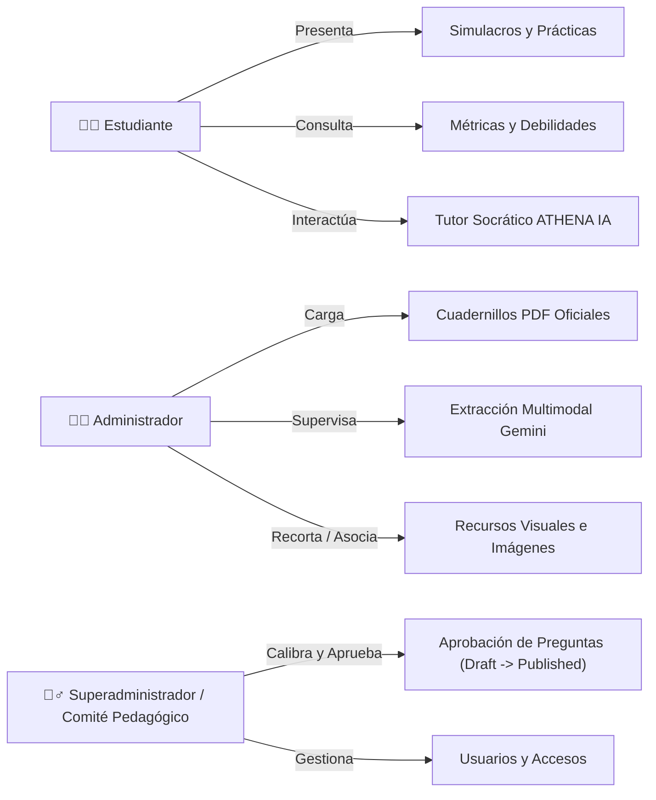
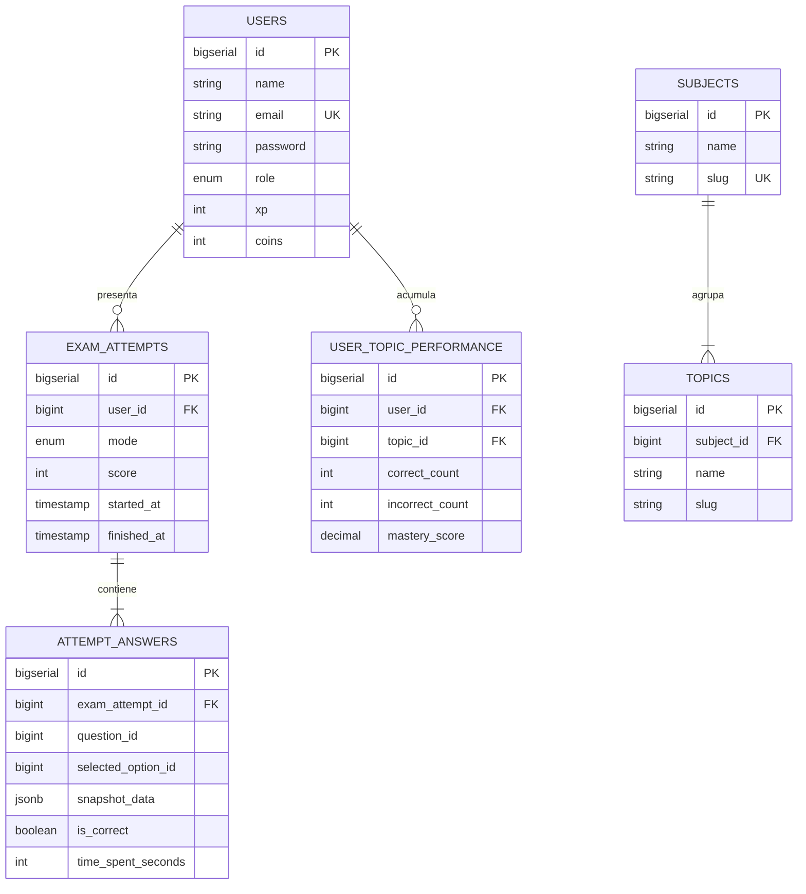

# ATHENA — PLATAFORMA DE PREPARACIÓN PARA LAS PRUEBAS SABER 11
## DOCUMENTACIÓN MAESTRA DEL PROYECTO
**Versión 1.0 — Versión Oficial Actualizada (Microservicios & Docker)**  
**Servicio Nacional de Aprendizaje – SENA**  
**Centro de Comercio y Servicios · Regional Cauca**  
**Ficha:** 3223898  
**Año:** 2026  

---

### Equipo de Desarrollo
- **Isabel Viviana Paredes**
- **Yosuad Valdez Castillo**
- **Franci Johana Rivera**
- **Sebastián Acebedo**
- **Jersin Benavidez**

---

### Control del Documento

| Campo | Detalle |
| :--- | :--- |
| **Nombre** | Documentación Maestra del Proyecto ATHENA |
| **Versión** | 1.0 – Consolidada y Actualizada frente al Código Fuente Real |
| **Estado** | Aprobada para desarrollo y despliegue contenerizado |
| **Responsables** | Equipo de desarrollo ATHENA – Ficha 3223898 |
| **Institución** | SENA – Regional Cauca (Centro de Comercio y Servicios) |
| **Propósito** | Consolidar la arquitectura real vigente, alcance del MVP, historias de usuario, modelo de datos políglota, infraestructura Docker y el registro de cambios respecto al borrador inicial. |

---

### Historial de Cambios

| Versión | Fecha | Descripción de Cambios | Responsable |
| :--- | :--- | :--- | :--- |
| **0.1** | Octubre 2026 | Borrador inicial preliminar (supuestos monolíticos Laragon, MySQL y propuestas sin contrastar). | Equipo ATHENA |
| **0.3** | Noviembre 2026 | Integración de contexto de migración, auditoría de respaldo y diseño de microservicio Question Bank. | Equipo ATHENA |
| **1.0** | Noviembre 2026 | **Versión Oficial Actualizada:** Incorporación de la arquitectura de microservicios contenerizados con Docker Compose, migración de Core a PostgreSQL 16 Alpine, desacoplamiento del microservicio `athena-question-bank` con Supabase (PostgreSQL + S3 Storage) y Gemini 2.5 Flash, pipeline de extracción de PDFs con `PdfImageExtractor.php`, Gateway Nginx en puerto 8080, Zustand en frontend y resolución de pendientes técnicos. | Yosuad Castillo / Equipo ATHENA |

---

## Tabla de Contenido

1. [Introducción y Justificación](#1-introducción-y-justificación)
2. [Identificación y Contexto del Proyecto](#2-identificación-y-contexto-del-proyecto)
3. [Objetivos del Proyecto](#3-objetivos-del-proyecto)
4. [Alcance, Límites y Delimitación del MVP](#4-alcance-límites-y-delimitación-del-mvp)
5. [Actores y Roles del Sistema](#5-actores-y-roles-del-sistema)
6. [Requisitos del Sistema (Funcionales y No Funcionales)](#6-requisitos-del-sistema-funcionales-y-no-funcionales)
7. [Historias de Usuario y Trazabilidad Técnica Real](#7-historias-de-usuario-y-trazabilidad-técnica-real)
8. [Arquitectura y Diseño Técnico Oficial](#8-arquitectura-y-diseño-técnico-oficial)
9. [Persistencia Políglota y Modelo de Datos](#9-persistencia-políglota-y-modelo-de-datos)
10. [Descripción Detallada de Módulos](#10-descripción-detallada-de-módulos)
11. [Interfaces, Identidad Visual y Experiencia de Usuario](#11-interfaces-identidad-visual-y-experiencia-de-usuario)
12. [Instalación, Configuración y Despliegue con Docker](#12-instalación-configuración-y-despliegue-con-docker)
13. [Integraciones Externas y Servicios Cloud](#13-integraciones-externas-y-servicios-cloud)
14. [Seguridad, Roles y Privacidad](#14-seguridad-roles-y-privacidad)
15. [Plan y Evidencias de Pruebas](#15-plan-y-evidencias-de-pruebas)
16. [Matriz Comparativa de Cambios (Delta v0.1 vs v1.0)](#16-matriz-comparativa-de-cambios-delta-v01-vs-v10)
17. [Glosario de Términos](#17-glosario-de-términos)

---

## 1. Introducción y Justificación

**ATHENA** es una plataforma tecnológica orientada a cerrar brechas de preparación académica para las pruebas de Estado **ICFES Saber 11** en Colombia. Tradicionalmente, los estudiantes enfrentan limitaciones para acceder a material oficial clasificado, simulacros con retroalimentación inmediata y acompañamiento personalizado para comprender por qué fallaron en una pregunta.

ATHENA soluciona esta problemática mediante:
1. **Simulacros y Prácticas Reales:** Evaluaciones configurables organizadas por las 5 áreas oficiales del ICFES (Matemáticas, Lectura Crítica, Ciencias Naturales, Sociales y Ciudadanas, e Inglés), implementando algoritmos que respetan la indivisibilidad de lecturas e infografías compartidas.
2. **Acompañamiento Socrático con IA:** El tutor inteligente **ATHENA IA** (representado por la identidad del *Zorro ATHENA*), impulsado por **Google Gemini**, que guía al alumno paso a paso para deducir la respuesta correcta sin dársela directamente.
3. **Ingesta y Extracción Automatizada:** Un microservicio desacoplado capaz de recibir cuadernillos oficiales en PDF y procesarlos con IA multimodal para extraer preguntas, enunciados, tablas, diagramas y opciones, acelerando la alimentación del banco.
4. **Infraestructura Contenerizada:** Despliegue estándar y reproducible bajo Docker Compose con imágenes publicadas en Docker Hub.

---

## 2. Identificación y Contexto del Proyecto

| Parámetro | Detalle Institucional |
| :--- | :--- |
| **Nombre Oficial** | ATHENA — Plataforma de Preparación para las Pruebas Saber 11 |
| **Institución** | Servicio Nacional de Aprendizaje – SENA |
| **Centro de Formación** | Centro de Comercio y Servicios |
| **Regional** | Regional Cauca |
| **Programa y Ficha** | Análisis y Desarrollo de Software (ADSO) — Ficha 3223898 |
| **Público Objetivo** | Estudiantes de educación media (grados 10° y 11°) y bachilleres graduados aspirantes a la educación superior |
| **Canales Oficiales** | Plataforma Web SPA (React 19) y Aplicación Móvil Android (Kotlin) |
| **Identidad Visual** | Mascota pedagógica *Zorro ATHENA* |

---

## 3. Objetivos del Proyecto

### 3.1 Objetivo General
Desarrollar, desplegar y operar una plataforma tecnológica integral (Web y Móvil) para la preparación de las pruebas ICFES Saber 11, integrando prácticas temáticas, simulacros con cronómetro, seguimiento analítico del rendimiento y tutoría socrática mediante inteligencia artificial.

### 3.2 Objetivos Específicos
1. **Módulo de Prácticas y Simulacros:** Diseñar un motor de exámenes que permita presentar simulacros rápidos diagnósticos (5 preguntas multi-área) y prácticas focalizadas (25 preguntas por materia) con registro inmutable (*snapshot*).
2. **Tutor Inteligente Socrático:** Integrar modelos de lenguaje avanzados (Google Gemini) contextualizados al reactivo evaluado, almacenando el historial de diálogo en una base NoSQL para trazabilidad pedagógica.
3. **Automatización de Ingesta de Reactivos:** Implementar un microservicio desacoplado (`athena-question-bank`) para la recepción de PDFs oficiales, extracción multimodal de enunciados y diagramas, y moderación pedagógica previa a publicación.
4. **Telemetría y Analítica de Maestría:** Calcular métricas acumulativas de desempeño por materia y subtema curricular para identificar debilidades de forma automatizada.
5. **Portabilidad y Despliegue Inmutable:** Contenerizar la totalidad de los componentes mediante Docker y Docker Compose, facilitando su ejecución con un único comando.

---

## 4. Alcance, Límites y Delimitación del MVP

### 4.1 Alcance Confirmado en el MVP Actual (Implementado y Funcional)
- ✅ Registro e inicio de sesión de estudiantes con tokens Bearer seguros (Laravel Sanctum).
- ✅ Panel administrativo para carga y gestión de cuadernillos PDF oficiales.
- ✅ Pipeline de extracción automática multimodal de preguntas desde PDF mediante Google Gemini 2.5 Flash y recorte de diagramas con `PdfImageExtractor.php`.
- ✅ Almacenamiento seguro de documentos e imágenes en Supabase Storage (buckets privados `icfes-documents` e `icfes-media`).
- ✅ Banco de reactivos moderable con estados: `draft`, `review`, `published`, `archived`.
- ✅ Selector de simulacros rápidos y prácticas focalizadas respetando la indivisibilidad de grupos de preguntas vinculadas a estímulos de lectura crítica.
- ✅ Calificación automática, congelamiento inmutable en `attempt_answers.snapshot_data` y cálculo de maestría por subtema.
- ✅ Tutor pedagógico socrático ATHENA IA integrado con Gemini y persistencia de sesiones en MongoDB Atlas.
- ✅ Orquestación completa en Docker Compose con 4 servicios (`athena-frontend`, `athena-backend`, `athena-question-bank`, `athena-db`).

### 4.2 Elementos Postergados para Fases Posteriores (Fuera del MVP Actual)
- ⏳ **Pasarelas de Pago Reales:** Integración bancaria en vivo (Wompi, PSE, tarjetas) postergada para la fase de comercialización institucional. En el MVP actual se dispone de la estructura de suscripciones y transacciones en esquema de datos, pero sin cobro bancario real.
- ⏳ **Google Play Billing y Cobro In-App:** Exclusivo de versiones móviles comerciales posteriores.
- ⏳ **Proctoring Biométrico Estricto:** Detección de mirada o cámara web no aplica para el entrenamiento libre del MVP.
- ⏳ **Tutoría por Voz o Videollamada en Tiempo Real:** El tutor funciona mediante chat interactivo textual con soporte matemático y Markdown.

---

## 5. Actores y Roles del Sistema



1. **Estudiante:** Usuario final autenticado. Presenta simulacros, consulta sus resultados históricos, revisa retroalimentaciones y chatea con el tutor ATHENA IA.
2. **Administrador:** Personal docente o técnico que carga cuadernillos PDF al microservicio, ejecuta la extracción IA y asocia imágenes/fórmulas recortadas.
3. **Superadministrador / Validador Pedagógico:** Revisa los reactivos extraídos, corrige enunciados o claves, y emite la aprobación final (`approve`) para que las preguntas pasen al banco activo.

---

## 6. Requisitos del Sistema (Funcionales y No Funcionales)

### 6.1 Requisitos Funcionales (RF)

| Código | Módulo | Descripción Funcional | Estado en v1.0 | Componente Responsable |
| :--- | :--- | :--- | :--- | :--- |
| **RF-01** | Cuentas y Acceso | Registro, inicio de sesión y gestión de credenciales con hashing seguro Argon2id/Bcrypt. | **Hecho** | Core Backend (Sanctum) / React SPA |
| **RF-02** | Prácticas Focalizadas | Selección de 1 materia y tema, generando 25 preguntas sin romper grupos de lectura crítica. | **Hecho** | Core Backend (`ExamService.php`) |
| **RF-03** | Simulacros Rápidos | Generación de diagnóstico multi-área de 5 preguntas (1 por cada área oficial ICFES). | **Hecho** | Core Backend (`ExamService.php`) |
| **RF-04** | Calificación y Snapshots | Calificación automática (0-100), congelando el enunciado y opciones en `snapshot_data` JSONB. | **Hecho** | Core Backend (PostgreSQL 16) |
| **RF-05** | Telemetría y Maestría | Actualización acumulativa de `mastery_score` por tema e historial cronológico de intentos. | **Hecho** | Core Backend (`ProgressService.php`) |
| **RF-06** | Tutor Socrático IA | Chat pedagógico guiado que orienta al estudiante sin entregar la respuesta directamente. | **Hecho** | Core Backend / Gemini Flash / MongoDB Atlas |
| **RF-07** | Ingesta de PDFs | Carga y almacenamiento de cuadernillos oficiales PDF en bucket privado S3. | **Hecho** | Microservicio `athena-question-bank` |
| **RF-08** | Extracción Multimodal IA | Procesamiento de cuadernillos con Gemini para extraer enunciados, fórmulas y solucionarios. | **Hecho** | Microservicio `athena-question-bank` |
| **RF-09** | Recorte de Figuras | Extracción de imágenes y gráficas desde el PDF mediante script `PdfImageExtractor.php`. | **Hecho** | Microservicio `athena-question-bank` |
| **RF-10** | Moderación Pedagógica | Interfaz web para editar, aprobar (`approve`) o rechazar (`reject`) preguntas extraídas. | **Hecho** | React (`QuestionMedia.jsx`, `questions.jsx`) |
| **RF-11** | Gateway Unificado | Proxy inverso Nginx que unifica frontend y APIs en un solo puerto externo (`8080`). | **Hecho** | Contenedor `athena-frontend` (Nginx) |

### 6.2 Requisitos No Funcionales (RNF)

| Atributo | Criterio Técnico Oficial | Mecanismo de Garantía en v1.0 |
| :--- | :--- | :--- |
| **Rendimiento** | Respuestas de API Core $< 200\text{ ms}$ en consultas operativas. | Caché en memoria, índices PostgreSQL y consultas optimizadas por Eloquent. |
| **Disponibilidad** | Recuperación ante fallos sin intervención manual. | Contenedores Docker con directiva `restart: unless-stopped` y *healthchecks* activos. |
| **Mantenibilidad** | Código desacoplado en microservicios independientes. | Separación estricta entre ATHENA Core (puerto 8000) y ATHENA Question Bank (puerto 8001). |
| **Seguridad** | Claves de API y credenciales de BD protegidas. | Ningún secreto expuesto en frontend; comunicación vía proxies internos y variables `.env`. |
| **Integridad de Datos** | Inmutabilidad de exámenes presentados. | Congelamiento de datos en tuplas `attempt_answers` mediante campo `snapshot_data`. |
| **Portabilidad** | Compatibilidad garantizada entre Windows, Linux y Mac. | Contenedores basados en imágenes estándar Alpine y Debian Bookworm (`php:8.3-cli`, `php:8.5-cli`, `nginx:1.25-alpine`). |

---

## 7. Historias de Usuario y Trazabilidad Técnica Real

A continuación se presenta el estado verificado de las Historias de Usuario en el código fuente actual:

### Módulo 1: Cuentas y Autenticación de Estudiantes
- **HU01 [Hecho]:** Registro con correo y contraseña. Implementado en `AuthController.php`, validación de unicidad de email y encriptación de claves.
- **HU02 [Por hacer en backend / Postergado]:** Registro OAuth con Google/Facebook. La interfaz web tiene los botones preparados; la integración con providers OAuth2 se encuentra aplazada.
- **HU03 [Hecho]:** Verificación y recuperación por correo mediante tokens de restablecimiento (`password_resets`).
- **HU04 [Hecho]:** Inicio de sesión con credenciales y emisión de token Bearer Sanctum. Redirección automática al Dashboard.
- **HU05 [Por hacer / Postergado]:** Inicio de sesión directo con redes sociales (OAuth2).
- **HU06 [Hecho]:** Recuperación de contraseña vía email y generación de nueva contraseña validada.

### Módulo 2: Autenticación y Gestión Administrativa
- **HU07 [Hecho]:** Creación de cuentas administrativas y asignación de rol `admin` en la base de datos PostgreSQL.
- **HU08 [Hecho]:** Inicio de sesión administrativo con control de acceso por roles (guards de Sanctum y middlewares de Laravel).
- **HU09 [Hecho]:** Restablecimiento de credenciales de administradores.
- **HU10 [Hecho]:** Suspensión o cambio de estado de usuarios mediante endpoints administrativos.

### Módulo 3: Suscripciones y Monetización (Esquema MVP)
- **HU12 [Hecho en BD]:** Período de acceso inicial registrado en `users.created_at`.
- **HU13 a HU16 [Postergado para Fase Comercial]:** La pasarela bancaria activa (Wompi/PSE) no está conectada en el MVP para evitar transacciones reales durante pruebas académicas del SENA. El esquema de datos de `subscriptions`, `subscription_plans` y `payment_transactions` está creado y verificado.

### Módulo 4: Perfil y Configuración
- **HU17 [Hecho]:** Actualización de datos personales (nombres, institución educativa, teléfono) mediante `PUT /api/profile/update`.
- **HU18 [Hecho]:** Cambio seguro de contraseña exigiendo la clave anterior.
- **HU19 [Hecho]:** Toggles de configuración de notificaciones en base de datos.
- **HU20 [Parcial]:** Visualización de avatar; carga a S3 en proceso de homologación con Supabase Storage.

### Módulo 5: Prácticas y Simulacros ICFES
- **HU21 [Hecho]:** Selector de materias y temas para prácticas focalizadas (`POST /api/exams/configure`).
- **HU22 [Hecho]:** Motor de selección atómica que garantiza la inclusión completa de preguntas asociadas a un mismo texto (`stimulus_id`).
- **HU23 [Hecho]:** Cronómetro interactivo en React con alertas visuales de tiempo restante y finalización automática.
- **HU24 [Hecho]:** Reporte post-examen con puntaje sobre 100, desglose de aciertos/errores, tiempo invertido y feedback socrático.
- **HU25 [Hecho]:** Historial cronológico con gráficas de rendimiento y acceso a intentos pasados (`GET /api/progress/history`).
- **HU26 [Hecho]:** Modo de examen simulado con condiciones de tiempo real.
- **HU27 [Hecho]:** Catalogación y edición de preguntas con soporte de fórmulas y diagramas en el microservicio Question Bank.

### Módulo 6: Tutor con Inteligencia Artificial (ATHENA IA)
- **HU29 [Hecho]:** Chat interactivo socrático en tiempo real con ATHENA IA contextualizado a la pregunta consultada.
- **HU30 [Hecho]:** Botón "Explicar con IA" que analiza las razones pedagógicas del fallo de una pregunta sin entregar la solución de forma directa.
- **HU31 [Hecho]:** Detección de temas débiles en `ProgressService::getWeaknesses` e inyección de contexto cognitivo al tutor.

---

## 8. Arquitectura y Diseño Técnico Oficial

### 8.1 Topología Multi-Contenedor (Docker Compose)

El sistema se orquesta mediante `docker-compose.yml` en la red privada `athena-network`:

```
                                      [ NAVEGADOR WEB ]
                                              │
                                       http://localhost:8080
                                              ▼
                             ┌──────────────────────────────────┐
                             │       athena-frontend            │
                             │  • Nginx 1.25 Alpine             │
                             │  • React 19 + Vite 8 SPA         │
                             └────────┬─────────────────┬───────┘
                                      │                 │
                         Proxy /api/* │                 │ Proxy /question-bank/*
                                      ▼                 ▼
             ┌──────────────────────────────────┐     ┌──────────────────────────────────┐
             │         athena-backend           │     │       athena-question-bank       │
             │  • Laravel 12 (PHP 8.3 CLI)      │     │  • Laravel 12 (PHP 8.5 CLI)      │
             │  • Core API (Auth, Exams, Stats) │     │  • Extracción PDF Gemini 2.5     │
             │  • Puerto interno: 8000          │     │  • Puerto interno: 8000          │
             └────────┬─────────────────┬───────┘     └────────┬─────────────────┬───────┘
                      │                 │                      │                 │
                      ▼                 ▼                      ▼                 ▼
              ┌──────────────┐   ┌──────────────┐      ┌──────────────┐   ┌──────────────┐
              │  athena-db   │   │MongoDB Atlas │      │   Supabase   │   │   Supabase   │
              │PostgreSQL 16 │   │ (NoSQL Cloud)│      │  PostgreSQL  │   │  Storage S3  │
              │ Puerto 5432  │   │   Chat IA    │      │  (Reactivos) │   │ (PDF/Imágenes│
              └──────────────┘   └──────────────┘      └──────────────┘   └──────────────┘
```

### 8.2 Características Clave de los Contenedores

| Servicio | Contenedor | Imagen Base / Hub | Puerto Host | Dependencias |
| :--- | :--- | :--- | :--- | :--- |
| **Frontend & Gateway** | `athena-frontend` | `castilloyosuad/athena-frontend:latest` | `8080:80` | `backend`, `question-bank` |
| **Core Backend** | `athena-backend` | `castilloyosuad/athena-backend:latest` | `8000:8000` | `db` (`condition: service_healthy`) |
| **Question Bank** | `athena-question-bank` | `castilloyosuad/athena-question-bank:latest` | `8001:8000` | Ninguna local (conecta a Supabase) |
| **Base de Datos Core** | `athena-db` | `postgres:16-alpine` | `5432:5432` | Ninguna |

---

## 9. Persistencia Políglota y Modelo de Datos

Para optimizar cada tipo de dato según su frecuencia de lectura, transaccionalidad y estructura, ATHENA implementa **persistencia políglota**:



1. **PostgreSQL 16 Alpine (`athena-db`):**
   - Maneja las transacciones críticas de alumnos, sesiones, exámenes y métricas.
   - Utiliza campos `jsonb` para almacenar `snapshot_data`, preservando el estado de las preguntas y opciones tal como fueron respondidas.
2. **MongoDB Atlas (Cloud NoSQL):**
   - Colección `ai_conversations`: Metadatos de la conversación.
   - Colección `ai_interactions`: Mensajes individuales, tokens consumidos y tiempos de respuesta.
   - Colección `ai_learning_contexts`: Instantánea de fortalezas y debilidades inyectadas en el prompt socrático.
3. **Supabase PostgreSQL & Storage S3 (Cloud):**
   - Tablas `documents`, `stimuli`, `questions`, `question_options`, `media_assets`.
   - Buckets S3 privados: `icfes-documents` (PDFs originales) e `icfes-media` (figuras y gráficas recortadas).

---

## 10. Descripción Detallada de Módulos

### 10.1 Módulo de Exámenes y Algoritmo de Indivisibilidad
Implementado en `ExamService.php`. Al solicitar una práctica por área:
1. Agrupa las preguntas disponibles en unidades atómicas:
   - Preguntas individuales (sin estímulo asociado).
   - Familias de preguntas (que comparten un mismo `stimulus_id`, como textos de Lectura Crítica).
2. Ejecuta un algoritmo combinatorio que selecciona exactamente 25 preguntas **sin fragmentar ningún grupo de lectura**.
3. Inicializa las tuplas en `attempt_answers` con el snapshot inmutable completo de cada reactivo.

### 10.2 Módulo de Extracción Multimodal con Gemini y Recorte
Implementado en `athena-question-bank`:
1. El administrador carga el PDF oficial en la interfaz web.
2. El documento se sube al bucket S3 `icfes-documents`.
3. Se dispara `ExtractionController::extract`:
   - Gemini 2.5 Flash analiza visual y textualmente las páginas, reconociendo enunciados y solucionarios.
   - `PdfImageExtractor.php` recorta las coordenadas de diagramas e infografías y las sube a `icfes-media`.
4. El reactivo queda en estado `draft` esperando calibración y aprobación del comité pedagógico.

---

## 11. Interfaces, Identidad Visual y Experiencia de Usuario

- **Identidad de Marca:** La interfaz está diseñada con tonos azules institucionales, detalles dorados y la presencia amigable del *Zorro ATHENA*, que celebra los logros del estudiante y lo motiva ante fallos.
- **Diseño Responsivo:** Desarrollado con **Tailwind CSS 4**, adaptable a pantallas de escritorio, tablets y dispositivos móviles.
- **Componentes Especializados:**
  - `QuestionMedia.jsx`: Componente administrativo para visualización, zoom y asociación de figuras extraídas.
  - `ExamTimer.jsx`: Barra de progreso de tiempo con notificaciones visuales y finalización segura.
  - `AIChatDrawer.jsx`: Ventana lateral de diálogo socrático accesible directamente desde la revisión del examen.

---

## 12. Instalación, Configuración y Despliegue con Docker

### Prerrequisitos
- **Docker Desktop** (con Docker Compose v2+) activo en Windows, Linux o macOS.
- Conexión a Internet para la descarga inicial de imágenes base.

### Paso 1: Configurar Variables de Entorno
Crea o ajusta el archivo `.env` en la raíz del proyecto si deseas personalizar servicios en la nube:

```env
# Google Gemini API
GEMINI_API_KEY=tu_api_key_de_gemini
GEMINI_MODEL=gemini-2.5-flash

# Supabase (Microservicio Question Bank)
QB_DB_HOST=aws-0-us-east-1.pooler.supabase.com
QB_DB_PORT=5432
QB_DB_DATABASE=postgres
QB_DB_USERNAME=postgres.tu_id_proyecto
QB_DB_PASSWORD=tu_password_supabase
QB_STORAGE_ENDPOINT=https://tu_id_proyecto.supabase.co/storage/v1/s3
QB_STORAGE_ACCESS_KEY=tu_s3_access_key
QB_STORAGE_SECRET_KEY=tu_s3_secret_key
```

### Paso 2: Despliegue con Docker Compose
Ejecuta en la terminal de la raíz del proyecto:

```bash
docker compose up -d --build
```

El script `entrypoint.sh` de los contenedores se encargará de:
1. Generar y persistir la `APP_KEY` de Laravel en volúmenes Docker.
2. Esperar a que PostgreSQL esté saludable (`pg_isready`).
3. Ejecutar las migraciones relacionales (`php artisan migrate --force`).
4. Iniciar los servidores HTTP de forma segura.

### Paso 3: Comprobación de Servicios
```bash
docker compose ps
```

Acceso disponible en el navegador:
👉 **`http://localhost:8080`**

---

## 13. Integraciones Externas y Servicios Cloud

| Servicio | Propósito | Configuración / Seguridad |
| :--- | :--- | :--- |
| **Google Gemini 2.5 Flash** | Extracción multimodal de PDFs y tutor pedagógico socrático. | Claves resguardadas exclusivamente en backend; nunca expuestas al cliente. |
| **Supabase PostgreSQL** | Catálogo oficial de reactivos, materias y temas del ICFES. | Conexión SSL obligatoria (`sslmode=require`). |
| **Supabase Storage S3** | Buckets privados `icfes-documents` e `icfes-media`. | Acceso mediante streaming autenticado o URLs firmadas temporales. |
| **MongoDB Atlas** | Almacenamiento no relacional de conversaciones y telemetría de IA. | Conexión mediante cadena cifrada `mongodb+srv://`. |

---

## 14. Seguridad, Roles y Privacidad

1. **Tokens Sanctum:** Toda la comunicación entre React y Laravel Core utiliza tokens Bearer revocables almacenados de forma segura.
2. **Aislamiento de Red:** Los servicios internos (`backend`, `question-bank`, `db`) residen en una red bridge interna (`athena-network`). Solo Nginx expone el puerto `8080` al exterior.
3. **Protección de Datos:** Las contraseñas de usuarios utilizan hashing estándar Argon2id / Bcrypt.
4. **Almacenamiento Privado de PDFs:** Los cuadernillos oficiales no son públicos en internet; se transmiten a través del backend bajo autorización.

---

## 15. Plan y Evidencias de Pruebas

- **Pruebas de Conectividad e Integridad:** Endpoints de diagnóstico implementados en `TestDbController`:
  - `GET /api/test-db/academic`: Verifica integridad de materias y temas.
  - `GET /api/test-db/hybrid`: Verifica conexión a PostgreSQL y MongoDB Atlas.
  - `GET /api/test-db/gemini`: Comprueba latencia con la API de Google Gemini.
- **Healthcheck del Microservicio:**
  - `GET /question-bank/api/v1/health` $\rightarrow$ `{"success": true, "status": "running"}`.
- **Pruebas de Regresión:** Verificación de algoritmos de examen con PHPUnit (`tests/Feature/AuthLoginTest.php`).

---

## 16. Matriz Comparativa de Cambios (Delta v0.1 vs v1.0)

| Elemento | Borrador v0.1 (Estado Preliminar) | Documentación Maestra v1.0 (Estado Real Vigente) |
| :--- | :--- | :--- |
| **Infraestructura** | Ejecución local en Laragon con puertos fragmentados (`5173`, `8000`, `8001`). | **Orquestación completa con Docker Compose**, red `athena-network` y Gateway Nginx en `8080`. |
| **Imágenes Docker** | Inexistentes. | Publicadas y etiquetadas en Docker Hub bajo `castilloyosuad/*`. |
| **Base Core** | MySQL 8.4 local en Laragon. | **PostgreSQL 16 Alpine** en contenedor Docker con salud monitoreada. |
| **Banco de Preguntas** | Mezclado en la misma base con 1.025 datos falsos de prueba. | **Microservicio desacoplado (`athena-question-bank`)** con Supabase Cloud. |
| **Ingesta de Cuadernillos**| Manual o mediante seeders estáticos. | **Extracción automática con Gemini 2.5 Flash** y recorte con `PdfImageExtractor.php`. |
| **Contratos de API** | Archivos vacíos (0 bytes en repositorios). | **Contratos formales y completos** en `04ContratoAPI.md` para Core y Question Bank. |
| **Frontend State** | Estados dispersos y advertencias de estilos. | **Zustand (`useAuthStore`)**, React 19 y Tailwind CSS 4 optimizado. |
| **Arranque del Sistema** | Comandos manuales en 3 terminales distintas. | Un único comando: `docker compose up -d --build`. |

---

## 17. Glosario de Términos

- **ICFES Saber 11:** Examen de Estado de la educación media en Colombia.
- **Estímulo:** Texto, gráfica, infografía o tabla contextual sobre la cual se formulan una o más preguntas dependientes.
- **Snapshot Inmutable:** Copia congelada en JSONB de la pregunta y sus opciones dentro de la tupla de respuesta, asegurando que ediciones futuras no alteren el histórico del estudiante.
- **Tutor Socrático:** Asistente pedagógico que formula preguntas orientadoras para que el alumno descubra su error por razonamiento propio.
- **API Gateway:** Punto de entrada único (Nginx) que recibe todo el tráfico externo y lo enruta al servicio correspondiente.
- **Docker Compose:** Herramienta para definir y ejecutar aplicaciones multi-contenedor Docker mediante un archivo YAML declarativo.
