# ATHENA — Plataforma Inteligente de Preparación para las Pruebas ICFES Saber 11

Bienvenido a la documentación oficial y actualizada del ecosistema **ATHENA**. Este documento detalla la arquitectura moderna de microservicios contenerizados, el desglose de componentes, contratos de API, infraestructura en Docker y el registro exhaustivo de cambios respecto a la versión monolítica anterior.

---

## 📑 Tabla de Contenidos

1. [Visión General del Sistema](#1-visión-general-del-sistema)
2. [Arquitectura General y Topología de Servicios](#2-arquitectura-general-y-topología-de-servicios)
3. [Registro de Cambios Recientes (Changelog de Evolución)](#3-registro-de-cambios-recientes-changelog-de-evolución)
4. [Componentes del Sistema](#4-componentes-del-sistema)
   - [4.1 Frontend — ATHENAreact](#41-frontend--athenareact)
   - [4.2 Backend Core — Repository-ATHENA-Laravel](#42-backend-core--repository-athena-laravel)
   - [4.3 Microservicio de Banco de Preguntas — athena-question-bank](#43-microservicio-de-banco-de-preguntas--athena-question-bank)
   - [4.4 Bases de Datos y Almacenamiento](#44-bases-de-datos-y-almacenamiento)
5. [Infraestructura Docker y Orquestación](#5-infraestructura-docker-y-orquestación)
6. [Contratos de API y Enrutamiento](#6-contratos-de-api-y-enrutamiento)
7. [Guía de Puesta en Marcha (Runbook para Desarrolladores)](#7-guía-de-puesta-en-marcha-runbook-para-desarrolladores)
8. [Variables de Entorno](#8-variables-de-entorno)

---

## 1. Visión General del Sistema

**ATHENA** es una suite educativa integral diseñada para maximizar el desempeño de estudiantes colombianos en las pruebas de Estado **ICFES Saber 11**. La plataforma combina:

- **Simulacros y Prácticas Focalizadas:** Evaluaciones con algoritmos que respetan la indivisibilidad de estímulos de lectura crítica y generan snapshots inmutables de intentos.
- **Tutor Inteligente ATHENA IA:** Asistente pedagógico socrático impulsado por **Google Gemini**, capaz de resolver dudas contextualizadas al rendimiento del alumno sin entregar la respuesta directamente.
- **Banco Oficial de Reactivos y Extracción Multimodal:** Microservicio especializado que procesa cuadernillos ICFES en formato PDF mediante IA multimodal, extrayendo enunciados, tablas, infografías y ecuaciones para alimentar el catálogo evaluativo.
- **Gamificación y Analítica:** Sistema de XP, monedas virtuales, logros, rachas y seguimiento de maestría por materia y tema curricular.

---

## 2. Arquitectura General y Topología de Servicios

El sistema abandonó el esquema monolítico local en Laragon y adoptó una **arquitectura distribuida basada en microservicios contenerizados con Docker Compose**:

```mermaid
flowchart TD
    subgraph Cliente["Navegador / Cliente"]
        User["Usuario / Estudiante / Administrador"]
    end

    subgraph DockerPlatform["Plataforma Contenerizada (athena-network)"]
        subgraph Gateway["Frontend Gateway (Puerto Host: 8080)"]
            Nginx["Nginx Reverse Proxy\n(athena-frontend / Port 80)"]
            ReactSPA["React 19 + Vite 8 SPA\n(Zustand + Tailwind 4)"]
            Nginx -->|Sirve estáticos| ReactSPA
        end

        subgraph CoreBackend["ATHENA Core Backend (Puerto Host: 8000)"]
            LaravelCore["Laravel 12 Core\n(PHP 8.3 CLI / Port 8000)"]
            AuthMod["Módulo Auth (Sanctum)"]
            ExamEngine["Motor de Exámenes y Algoritmos"]
            ProgressMod["Analítica y Gamificación"]
            LaravelCore --- AuthMod
            LaravelCore --- ExamEngine
            LaravelCore --- ProgressMod
        end

        subgraph QuestionBankService["ATHENA Question Bank (Puerto Host: 8001)"]
            LaravelQB["Laravel 12 Question Bank\n(PHP 8.5 CLI / Port 8000)"]
            PdfExtractor["PdfImageExtractor\n(Extracción de imágenes & OCR)"]
            GeminiExtract["Extractor Multimodal Gemini"]
            AdminCatalog["Moderación y Calibración Pedagógica"]
            LaravelQB --- PdfExtractor
            LaravelQB --- GeminiExtract
            LaravelQB --- AdminCatalog
        end

        subgraph CoreDB["Base de Datos Core (Puerto Host: 5432)"]
            PostgresCore[("PostgreSQL 16 Alpine\n(athena-db / BD: Athena)")]
        end
    end

    subgraph ExternalServices["Servicios Externos / Cloud"]
        MongoAtlas[("MongoDB Atlas\n(Historial IA: ai_conversations)")]
        SupabasePG[("Supabase PostgreSQL\n(Banco Oficial ICFES)")]
        SupabaseStorage[("Supabase Storage (S3)\n(icfes-documents & icfes-media)")]
        GeminiAPI["Google Gemini 2.5 Flash API"]
    end

    %% Routing
    User -->|HTTP Requests| Nginx
    Nginx -->|/api/*| LaravelCore
    Nginx -->|/question-bank/*| LaravelQB

    %% Core Data Flow
    LaravelCore -->|Persistencia relacional| PostgresCore
    LaravelCore -->|Sesiones y chat IA| MongoAtlas
    LaravelCore -->|Consultas tutor socrático| GeminiAPI

    %% Question Bank Data Flow
    LaravelQB -->|Catálogo y preguntas oficiales| SupabasePG
    LaravelQB -->|PDFs y recortes de gráficos| SupabaseStorage
    LaravelQB -->|Análisis y visión multimodal| GeminiAPI
```



---

## 3. Registro de Cambios Recientes (Changelog de Evolución)

A continuación se detalla la comparativa entre la versión previa y la versión actual:

| Dimensión | Estado Anterior (Monolito Local) | Estado Actual (Arquitectura Dockerizada) | Justificación del Cambio |
| :--- | :--- | :--- | :--- |
| **Orquestación** | Manual en Laragon (Windows) | **Docker Compose multi-contenedor** con red bridge dedicada (`athena-network`). | Garantiza portabilidad idéntica entre desarrollo, pruebas y producción sin depender de configuraciones locales. |
| **Imágenes Docker** | No existían | Registradas y tagueadas en Docker Hub:<br>• `castilloyosuad/athena-frontend:latest`<br>• `castilloyosuad/athena-backend:latest`<br>• `castilloyosuad/athena-question-bank:latest` | Despliegue CI/CD acelerado e inmutable. |
| **Banco de Preguntas** | Tablas integradas en la misma base de datos con datos de prueba sintéticos. | **Microservicio desacoplado (`athena-question-bank`)** con API REST versionada (`/api/v1/`). | Independiza la ingesta masiva de cuadernillos y visión computacional del backend transaccional de usuarios. |
| **Base de Datos Core** | MySQL 8.4 local en Laragon | **PostgreSQL 16 Alpine** en contenedor (`athena-db`), migrado con PDO pgsql. | Mayor consistencia transaccional, soporte nativo de JSONB y paridad con entornos de nube. |
| **Base de Preguntas** | Sintética (1.025 registros de prueba fakers) | **Supabase PostgreSQL + Storage S3** (`icfes-documents`, `icfes-media`). | Almacenamiento seguro en la nube de reactivos reales, cuadernillos oficiales e imágenes recortadas. |
| **Extracción de Preguntas** | Manual / Seeders | **Extracción multimodal automática con Google Gemini** + script `PdfImageExtractor.php`. | Procesamiento de cuadernillos PDF completos extrayendo texto, gráficas, opciones y solucionarios en minutos. |
| **Enrutamiento Web** | Múltiples puertos independientes sin proxy inverso | **Nginx Reverse Proxy en Frontend**: mapea `/api/` hacia el backend Core y `/question-bank/` hacia el microservicio. | Evita problemas de CORS en producción y unifica el punto de entrada bajo el puerto host `8080`. |
| **Frontend State** | Context API / Estados dispersos | **Zustand (`useAuthStore`)** + React 19 + Tailwind CSS 4. | Manejo centralizado, reactivo y de alto rendimiento del estado de sesión y catálogo. |
| **Ciclo de Vida de Contenedores** | Manual | Scripts `entrypoint.sh` automatizados con generación de `APP_KEY`, verificación de base de datos (`until php PDO...`) y ejecución de migraciones automáticas. | Auto-recuperación y arranque sin intervención manual. |

---

## 4. Componentes del Sistema

### 4.1 Frontend — ATHENAreact

- **Ubicación:** `./ATHENAreact`
- **Tecnologías:** React 19, Vite 8, Tailwind CSS 4, Axios, Zustand, Nginx 1.25 Alpine.
- **Responsabilidades:**
  - Interfaz de estudiante: Registro, Login, Dashboard de métricas, Simulacros rápidos (5 preguntas diagnóstico), Prácticas por materia (25 preguntas con lecturas indivisibles), Historial y Chat con tutor IA.
  - Interfaz de administrador (`/admin/questions`): Carga de cuadernillos PDF, visualización de progreso de extracción, visor y recorte de recursos multimedia (`QuestionMedia.jsx`), revisión pedagógica y calibración de opciones.
  - Gateway Nginx: Expuesto en el puerto host `8080`. Sirve la SPA y redirige peticiones de backend mediante proxy reverso sin exponer puertos internos.

### 4.2 Backend Core — Repository-ATHENA-Laravel

- **Ubicación:** `./Repository-ATHENA-Laravel`
- **Tecnologías:** Laravel 12, PHP 8.3 CLI, Laravel Sanctum, PostgreSQL Driver (`pdo_pgsql`), MongoDB PHP Driver (`mongodb-1.21.5`).
- **Responsabilidades:**
  - Autenticación, roles y perfiles de estudiantes y administradores.
  - Motor de simulación y evaluación (`ExamService.php`):
    - **Simulacro Rápido:** 5 preguntas (1 por cada área básica).
    - **Práctica Focalizada:** 25 preguntas agrupadas respetando la indivisibilidad de estímulos compartidos.
    - **Congelamiento de Instantánea:** Persistencia inmutable en `attempt_answers.snapshot_data`.
    - **Cálculo de Maestría:** Actualización incremental en `user_topic_performance`.
  - Tutor ATHENA IA: Orquestación socrática mediante Gemini API y almacenamiento de sesiones y mensajes en MongoDB Atlas.

### 4.3 Microservicio de Banco de Preguntas — athena-question-bank

- **Ubicación:** `./athena-question-bank`
- **Tecnologías:** Laravel 12, PHP 8.5 CLI, PostgreSQL Supabase, S3 Client, Google Gemini SDK.
- **Responsabilidades:**
  - Almacenamiento seguro de cuadernillos oficiales PDF en bucket `icfes-documents`.
  - Pipeline de extracción multimodal:
    - Extracción de texto y razonamiento estructural con Gemini 2.5 Flash.
    - Extracción y recorte de figuras/gráficos con `PdfImageExtractor.php` y almacenamiento en bucket `icfes-media`.
  - Moderación y aprobación pedagógica de reactivos (estados: `draft`, `review`, `published`, `archived`).
  - Generación de paquetes (bundles) de preguntas mediante API REST.

### 4.4 Bases de Datos y Almacenamiento

1. **PostgreSQL 16 (Contenedor `athena-db`):**
   - Aloja la base de datos `Athena` del Core Backend (usuarios, intentos, respuestas congeladas, rendimiento, logros, notificaciones).
   - Volumen persistente: `athena-pg-data`.
2. **MongoDB Atlas (Cloud):**
   - Aloja las colecciones NoSQL conversacionales: `ai_conversations`, `ai_interactions`, `ai_learning_contexts`.
3. **Supabase PostgreSQL & Storage (Cloud):**
   - Aloja la estructura especializada del banco de preguntas ICFES.
   - Buckets S3 privados: `icfes-documents` (PDFs originales) e `icfes-media` (imágenes de reactivos y fórmulas recortadas).

---

## 5. Infraestructura Docker y Orquestación

El archivo orquestador principal es `docker-compose.yml`:

```yaml
services:
  frontend:
    image: castilloyosuad/athena-frontend:latest
    build:
      context: ./ATHENAreact
      dockerfile: dockerfile
    container_name: athena-frontend
    ports:
      - "8080:80"
    networks:
      - athena-network

  backend:
    image: castilloyosuad/athena-backend:latest
    build:
      context: ./Repository-ATHENA-Laravel
      dockerfile: dockerfile
    container_name: athena-backend
    ports:
      - "8000:8000"
    networks:
      - athena-network
    depends_on:
      db:
        condition: service_healthy

  question-bank:
    image: castilloyosuad/athena-question-bank:latest
    build:
      context: ./athena-question-bank
      dockerfile: dockerfile
    container_name: athena-question-bank
    ports:
      - "8001:8000"
    networks:
      - athena-network

  db:
    image: postgres:16-alpine
    container_name: athena-db
    ports:
      - "5432:5432"
    environment:
      POSTGRES_DB: Athena
      POSTGRES_USER: sail
      POSTGRES_PASSWORD: password
    volumes:
      - athena-pg-data:/var/lib/postgresql/data
    healthcheck:
      test: ["CMD-SHELL", "pg_isready -U sail -d Athena"]
      interval: 5s
      timeout: 5s
      retries: 30
      start_period: 25s
    networks:
      - athena-network
```

### Volúmenes Persistentes
- `athena-pg-data`: Garantiza que los datos de PostgreSQL no se pierdan al reiniciar o destruir contenedores.
- `athena-app-key` y `athena-qb-app-key`: Almacenan de forma segura y persistente la `APP_KEY` generada automáticamente para cada microservicio Laravel.

---

## 6. Contratos de API y Enrutamiento

### 6.1 Mapeo de Nginx Gateway (Puerto Host 8080)

| Ruta Externa | Destino Interno | Descripción |
| :--- | :--- | :--- |
| `http://localhost:8080/` | `athena-frontend:80` | Aplicación SPA de React 19. |
| `http://localhost:8080/api/*` | `athena-backend:8000/api/*` | API REST del Core Backend de ATHENA. |
| `http://localhost:8080/question-bank/*` | `athena-question-bank:8000/*` | API REST del Microservicio de Banco de Preguntas. |

---

### 6.2 Endpoints del Microservicio de Banco de Preguntas (`/question-bank/api/v1`)

| Método | Endpoint | Descripción |
| :--- | :--- | :--- |
| `GET` | `/health` | Healthcheck autónomo del microservicio. |
| `GET` | `/admin/catalogs/subjects` | Listado de áreas académicas oficiales ICFES. |
| `GET` | `/admin/catalogs/topics` | Listado de temas curriculares por materia (`?subject_id=X`). |
| `GET` | `/admin/documents` | Listado paginado de documentos PDF registrados. |
| `POST` | `/admin/documents` | Carga de nuevo cuadernillo PDF a Supabase Storage y registro en BD. |
| `GET` | `/admin/documents/{id}` | Detalle del documento y generación de URL firmada temporal. |
| `DELETE` | `/admin/documents/{id}` | Eliminación de documento y sus activos. |
| `POST` | `/admin/documents/{id}/extract` | Disparo del pipeline de extracción multimodal con Google Gemini. |
| `GET` | `/admin/documents/{id}/extraction-status` | Consulta del estado y progreso de la extracción del documento. |
| `GET` | `/admin/documents/{id}/extracted-questions` | Obtención de las preguntas, opciones y estímulos extraídos. |
| `GET` | `/admin/documents/{id}/media` | Manifiesto de figuras e imágenes extraídas del documento. |
| `GET` | `/admin/media` | Streaming seguro de imagen/gráfico desde bucket privado (`?path=X`). |
| `GET` | `/admin/questions` | Listado paginado de preguntas con filtros (`status`, `subject_id`). |
| `GET` | `/admin/questions/{id}` | Detalle completo de un reactivo, opciones y estímulo asociado. |
| `PUT` | `/admin/questions/{id}` | Edición de enunciado, opciones, clave correcta y justificación pedagógica. |
| `POST` | `/admin/questions/{id}/approve` | Aprobación pedagógica para incorporación al banco oficial activo. |
| `POST` | `/admin/questions/{id}/reject` | Rechazo y pase al estado archivado. |

---

### 6.3 Endpoints del Core Backend (`/api`)

| Grupo / Prefijo | Endpoints Clave | Descripción |
| :--- | :--- | :--- |
| **`auth/`** | `POST /login`, `POST /register`, `POST /logout`, `GET /me` | Autenticación con Laravel Sanctum y control de sesiones. |
| **`exams/`** | `POST /configure`, `GET /{id}/questions`, `POST /{id}/answers`, `POST /{id}/finish`, `GET /{id}/results` | Motor de simulacros rápidos, prácticas indivisibles y calificación con snapshot inmutable. |
| **`progress/`** | `GET /general-stats`, `GET /subject-performance`, `GET /history`, `GET /weaknesses` | Telemetría de desempeño, cálculo de percentiles y maestría. |
| **`ai/`** | `POST /chat`, `GET /conversations`, `GET /conversations/{id}` | Interacción con el tutor inteligente socrático ATHENA IA. |
| **`profile/`** | `GET /`, `PUT /update`, `GET /achievements` | Perfil del estudiante, XP, monedas y logros desbloqueados. |
| **`test-db/`** | `GET /integrity`, `GET /academic`, `GET /simulators`, `GET /hybrid`, `GET /gemini` | Endpoints de diagnóstico y auditoría interna de bases de datos. |

---

## 7. Guía de Puesta en Marcha (Runbook para Desarrolladores)

### Prerrequisitos
- **Docker Desktop** (con Docker Compose v2+) activo en Windows/Linux/macOS.
- Conexión a Internet para la descarga de dependencias e imágenes base en la primera ejecución.

### Paso 1: Clonar e Ingresar al Directorio Raíz
```bash
cd "c:\Users\Yosuad Castillo\proyecto-ATHENA"
```

### Paso 2: Configurar Variables de Entorno
Crea o ajusta el archivo `.env` en la raíz si deseas personalizar credenciales remotas (Gemini API Key, Supabase Keys):
```env
GEMINI_API_KEY=tu_clave_gemini_aqui
GEMINI_MODEL=gemini-2.5-flash
QB_DB_HOST=aws-0-us-east-1.pooler.supabase.com
QB_DB_PORT=5432
QB_DB_DATABASE=postgres
QB_DB_USERNAME=postgres.tu_id_proyecto
QB_DB_PASSWORD=tu_password_supabase
QB_STORAGE_ENDPOINT=https://tu_id_proyecto.supabase.co/storage/v1/s3
QB_STORAGE_ACCESS_KEY=tu_access_key
QB_STORAGE_SECRET_KEY=tu_secret_key
```

### Paso 3: Iniciar Todo el Stack con Docker Compose
```bash
docker compose up -d --build
```

### Paso 4: Comprobar el Estado de los Contenedores
```bash
docker compose ps
```
Los cuatro servicios deben mostrarse en estado `Up` o `healthy`:
- `athena-frontend`: `http://localhost:8080`
- `athena-backend`: `http://localhost:8000`
- `athena-question-bank`: `http://localhost:8001`
- `athena-db`: `localhost:5432` (healthy)

### Paso 5: Verificar Healthchecks
- **Question Bank:**
  ```bash
  curl http://localhost:8080/question-bank/api/v1/health
  ```
  *Respuesta:* `{"success":true,"service":"ATHENA Question Bank","version":"1.0.0","status":"running"}`

- **Core Backend Integrity:**
  ```bash
  curl http://localhost:8080/api/test-db/academic
  ```

### Paso 6: Acceso a la Plataforma
Abre tu navegador en:
👉 **`http://localhost:8080`**

---

## 8. Licencia y Equipo de Desarrollo

Proyecto desarrollado y mantenido por el equipo **ATHENA** para la innovación educativa y la preparación para las pruebas Saber 11 en Colombia.
